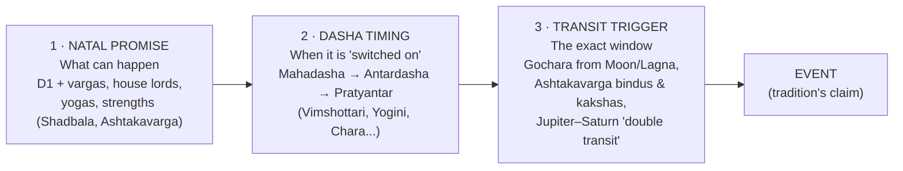
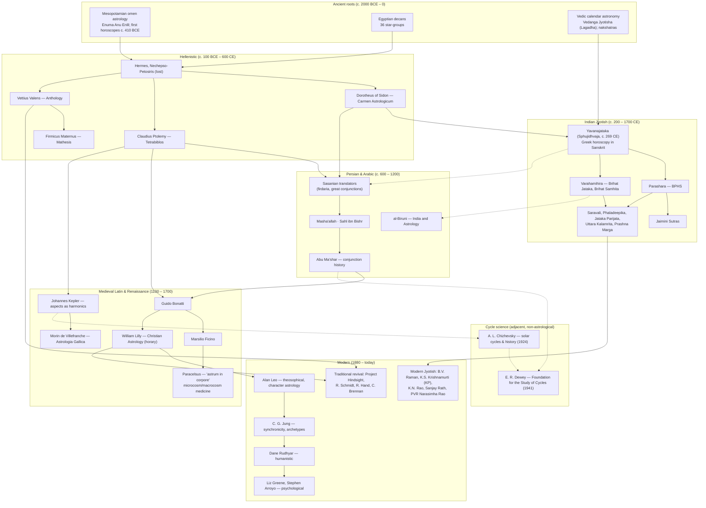

# How Astrology Works — the Master Map

> **What this file is.** The entry point to the knowledge base. It explains the moving parts of any horoscope, how a chart is actually computed, how astrologers move from a birth chart to a timed prediction, and how the world's traditions and thinkers relate to one another.
>
> **Related files**
> - [02-vedic-jyotish.md](02-vedic-jyotish.md): Vedic masters, texts and techniques in depth
> - [03-reading-parasharas-light.md](03-reading-parasharas-light.md): field guide to the Parashara's Light screen, worked through on our reference chart
> - [04-software.md](04-software.md): software landscape and recommendation
> - [10-cycles-thinkers.md](10-cycles-thinkers.md): cycle science and individual thinkers (Dewey, Chizhevsky and others)

---

## 1. The five building blocks

Every astrological tradition, whether Vedic, Hellenistic, medieval or modern, combines the same five kinds of object. They differ mainly in which objects they weight most and in how they turn them into dates.

| Block | What it is physically | What it means symbolically | Vedic term |
|---|---|---|---|
| **Planets** | The Sun, the Moon and the visible planets (Mercury through Saturn), plus the lunar nodes. Modern Western astrology adds Uranus, Neptune and Pluto. | The *actors*: drives, people and significations (e.g. Venus = relationships, pleasure) | *graha* ("seizer") |
| **Signs** | 12 equal 30° divisions of the ecliptic, the Sun's apparent yearly path | The *style or costume* a planet wears (element, modality, ruler) | *rashi* |
| **Houses** | 12 divisions of the *local* sky, counted from the eastern horizon (the Ascendant, or Lagna) | The *arena of life* (1 = self, 7 = partner, 10 = career, …) | *bhava* |
| **Aspects** | Angular relationships between planets | *Interactions*: which actors influence which | *drishti* |
| **Time-lords** | Rules that hand out periods of life to particular planets or signs | *When* each part of the promise becomes active | *dasha* |

Two further elements matter a great deal in India and much less in the West:

- **Lunar mansions** (*nakshatra*): 27 divisions of 13°20′ each, defined by the Moon's daily motion. The Moon's nakshatra at birth seeds the Vimshottari dasha.
- **Divisional charts** (*varga*): the same chart re-sliced at finer resolution (D9, D10, …) to judge particular topics.

### 1.1 Signs, rulers and dignity
Each sign has a ruling planet. Most traditions use the same "Thema Mundi" scheme: Sun–Leo, Moon–Cancer, Mercury–Gemini/Virgo, Venus–Taurus/Libra, Mars–Aries/Scorpio, Jupiter–Sagittarius/Pisces, Saturn–Capricorn/Aquarius. A planet is strong in its own sign and in its **exaltation** sign (e.g. Saturn in Libra), and weak in its **debilitation** or *fall* sign, the sign opposite exaltation (Saturn in Aries). Ptolemy (*Tetrabiblos* I.17–22), Parashara (*BPHS* ch. 3) and Varahamihira (*Brihat Jataka* ch. 1) give essentially the same exaltation table. This is one of the clearest signs of shared Hellenistic–Indian roots.

### 1.2 Houses
The Ascendant is the degree of the ecliptic rising on the eastern horizon at the birth place and moment. It moves through the whole zodiac about once every 24 hours, so it changes by roughly **1° every 4 minutes**. This is why the birth time matters so much. Systems for dividing the houses include:

- **Whole sign** (the oldest, used in Hellenistic astrology and most Jyotish): the rising sign is the 1st house, the next sign the 2nd, and so on.
- **Equal / Bhava-chalit / Sripati**: houses measured from the Ascendant degree.
- **Quadrant systems** (Porphyry, Alcabitius, Regiomontanus, **Placidus**, Koch): divide the sky by time or space between the four angles. Placidus is the modern Western default, and KP uses it too.

### 1.3 Aspects
- **Western/Hellenistic:** geometric aspects between degrees, namely conjunction 0°, sextile 60°, square 90°, trine 120°, opposition 180°, each with an *orb*. Kepler added minor aspects (quintile 72°, etc.).
- **Vedic (Parashari):** every planet fully aspects the 7th sign/house from itself. Mars also aspects the 4th and 8th, Jupiter the 5th and 9th, and Saturn the 3rd and 10th (*BPHS* ch. 26; *Brihat Jataka* ch. 2). Jaimini adds **sign aspects** (*rashi drishti*): movable signs aspect fixed signs except the adjacent one, and dual signs aspect each other.

### 1.4 Time-lords
Here the traditions diverge most:
- **Vedic:** *dashas*: Vimshottari (120-year cycle keyed to the Moon's nakshatra), Yogini, Chara, Kalachakra and others.
- **Hellenistic:** annual profections, zodiacal releasing, decennials, firdaria (Persian), and primary directions (Ptolemy, *Tetrabiblos* III.10).
- **Modern Western:** secondary progressions ("a day for a year"), solar-arc directions, solar returns, transits.

---

## 2. Sidereal vs tropical, and the ayanamsa

The zodiac can be anchored in two ways:

- **Tropical** (Western): 0° Aries = the **vernal equinox**, where the Sun crosses the celestial equator in March. Signs are tied to the seasons.
- **Sidereal** (Vedic, and Western siderealists such as Fagan and Bradley): 0° Aries is tied to the **fixed stars**.

The Earth's axis wobbles (precession, a cycle of about 25,770 years, roughly 50.3″ per year), so the equinox slides backward against the stars. The gap between the two zodiacs is the **ayanamsa**:

```
sidereal longitude = tropical longitude − ayanamsa
```

| Ayanamsa | Anchor / origin | Value, 22 Jun 1999 | Notes |
|---|---|---|---|
| **Lahiri (Chitrapaksha)** | Star Spica (Chitra) fixed at 180° | ≈ 23°51′ | Adopted by India's Calendar Reform Committee (N. C. Lahiri, 1955). Default in Parashara's Light and most Indian software. About **24°13′ in 2026**. |
| Raman | B. V. Raman's value | ≈ 22°24′ | About 1°27′ less than Lahiri |
| KP (Krishnamurti) | close to Lahiri | ≈ 23°45′ | Differs by about 6′ |
| Fagan–Bradley | Western sidereal | ≈ 24°44′ | About 0°53′ more than Lahiri |
| True Chitra / True Pushya / Yukteswar | various | — | Debated among specialists |

Because the gap is about 24°, about **80% of people have a different Sun sign** in the two systems. Our reference chart's Sun is at tropical ≈ Cancer 0°48′ but sidereal **Gemini 6°57′**. Neither zodiac is "the real one"; they are different coordinate conventions.

---

## 3. How a chart is computed (ephemeris + time + place)

```
 birth data                     astronomy                         astrology layer
 ──────────                     ─────────                         ───────────────
 date, clock time ─► convert to UT ─► Julian Day ─► ephemeris ─► geocentric ecliptic
 time zone / DST                       (+ΔT → TT)   (JPL DE / Swiss   longitudes of planets
                                                     Ephemeris)        │
 latitude, longitude ─► local sidereal time ─► Ascendant & MC          │
                                                     │                 │
                                                     └───► − ayanamsa ◄┘ (sidereal only)
                                                                │
                                         signs, houses, nakshatras, vargas, dashas, ...
```

Worked through for the reference chart (22 Jun 1999, 21:35 IST, Mumbai 19.08° N, 72.88° E):

1. **Clock time → UT.** IST = UT + 5:30, so the birth time is 16:05 UT. (Old charts need historical time-zone and war-time/DST data; mistakes here are the most common source of chart errors.)
2. **Julian Day.** A continuous day count used in astronomy: JD ≈ 2451352.170. The ephemeris also needs ΔT, the small difference between atomic and Earth-rotation time (about 64 s in 1999).
3. **Planet positions.** The program looks up the planets' geocentric apparent ecliptic longitudes in an **ephemeris**. Today that is almost always NASA/JPL's numerical integrations (DE431/DE440) in the compressed form of the **Swiss Ephemeris**, accurate to well under an arcsecond for modern dates. See [04-software.md](04-software.md).
4. **Ascendant.** From UT and the birth longitude the program computes the local sidereal time, then RAMC (the right ascension of the meridian). It then solves
   `Asc = atan2( cos RAMC, −(sin RAMC · cos ε + tan φ · sin ε) )`
   where ε is the obliquity of the ecliptic (about 23.44°) and φ is the latitude.
5. **Sidereal conversion.** Subtract the Lahiri ayanamsa (about 23°51′). The result is Lagna Capricorn 11°29′, Sun Gemini 6°57′, Moon Virgo 28°32′, and so on. Recomputing with pyswisseph gives the same values to the arcminute.
6. **Derived layers.** Everything else is arithmetic on these longitudes: signs and houses, nakshatras and padas (13°20′ and 3°20′ steps), divisional charts, dasha balances (from the Moon's position within its nakshatra), Ashtakavarga, Shadbala.

**Sensitivity.** A 4-minute error in birth time shifts the Lagna by about 1° and the D9 Lagna by about 9°. A 2-minute error can change the D60. The Moon moves about 13° a day, so a 1′ error in the Moon's position shifts dasha dates by several days. "Rectification" is the practice of adjusting an uncertain birth time to fit known life events.

**Rahu/Ketu.** The lunar nodes come in two versions. The *mean* node is smoothed; the *true* node oscillates around it. In the reference chart the true node is Cancer 20°05′ (the value Parashara's Light shows) and the mean node is Cancer 21°24′. Software lets you choose.

---

## 4. The logic of prediction: promise → timing → trigger

Traditional astrologers in every school use the same three-layer logic. The Vedic version is the most explicit.



1. **Promise.** Is the matter shown at all in the birth chart? A common maxim: *"what is not promised in the natal chart, the dasha cannot give, and transit cannot give."* Practitioners judge the relevant house, its lord, its natural significator (*karaka*), and the matching divisional chart (e.g. the D10 for career). Varahamihira (*Brihat Jataka* ch. 1) and Parashara (*BPHS* chs. 11–24) lay out house judgement in this way.
2. **Timing.** The dasha lords whose period is running activate the houses they own, occupy and aspect. In the reference chart the Jupiter mahadasha (2021–2037) is said to activate Jupiter's matters: it rules the 3rd and 12th houses, sits in the 4th, and aspects the 8th, 10th and 12th.
3. **Trigger.** Slow transits (Saturn and Jupiter, and in India the nodes) touching the natal points that the dasha has activated fix the window. K. N. Rao popularised the "double transit" rule: Jupiter and Saturn must both influence a house or its lord for a major event of that house.

Western and Hellenistic practice runs on the same logic with different tools: natal promise → profections, zodiacal releasing or progressions → transits and solar returns.

---

## 5. Map of traditions and thinkers



Solid arrows show documented textual transmission. Dotted arrows show conceptual kinship or influence (for example, Abu Ma'shar's long-cycle history prefigures Dewey's search for periodicities, but Dewey did not draw on him). The individual cycle thinkers are covered in [10-cycles-thinkers.md](10-cycles-thinkers.md).

### Key relationships in prose
- **Shared ancestry.** Mesopotamian omen astrology and Egyptian decans fed Hellenistic horoscopy. Hellenistic horoscopy then reached India; the *Yavanajataka* (literally "horoscopy of the Greeks") is the clearest bridge. Native Indian lunar astronomy (nakshatras) and later Indian innovation (dashas, vargas, yogas) produced a distinct system.
- **Persian synthesis.** Sasanian and early Abbasid astrologers absorbed Greek, Indian and Persian material and passed it on to Latin Europe through 12th-century translations from Arabic.
- **Renaissance turn.** Ficino and **Paracelsus** reframed astrology as a natural philosophy of correspondences: the "inner firmament" in the human body. Kepler kept aspects but rejected most of the rest. Lilly codified horary.
- **Modern psychological astrology** (Leo → Jung → Rudhyar → Greene) moved from event prediction to character and growth. The **traditional revival** since the 1990s has translated the Greek and Latin sources and brought back whole-sign houses and time-lord techniques.
- **Cycle science** (Chizhevsky's heliobiology, Dewey's statistical cycle hunting) is *not* astrology. It looks for physical or statistical periodicities, such as the 11-year solar cycle, but it appeals to the same intuition that sky and society move in rhythm, and so belongs on this map.

---

## 6. A note on scientific status

Astrology is a coherent symbolic and historical system. It is worth studying for its texts, its mathematics, its cultural influence and its use as a reflective language. As a **predictive science**, though, controlled tests have not supported it:

- **Carlson (1985, *Nature* 318).** In a double-blind test, astrologers matched natal charts to personality profiles (CPI) no better than chance.
- **Dean & Kelly (2003, *Journal of Consciousness Studies* 10).** About 2,000 "time twins" born minutes apart showed no meaningful similarity across about 100 measured traits.
- **Narlikar et al. (2009, *Current Science* 96).** In an Indian test, Vedic astrologers tried to tell the charts of 100 academically gifted children from the charts of 100 children with intellectual disabilities. They did no better than chance.
- Michel Gauquelin's "Mars effect" (sports champions with Mars in key sectors) is the most-discussed positive claim. It remains disputed and does not validate signs, houses or dashas.

This knowledge base therefore presents interpretations as **what the tradition says**, not as established fact.

---

## 7. Glossary

| Term | Meaning |
|---|---|
| Ascendant / Lagna | Ecliptic degree rising on the eastern horizon |
| MC / Midheaven | Ecliptic degree culminating on the meridian |
| Ayanamsa | Offset between the tropical and sidereal zodiacs |
| Ephemeris | Table or algorithm giving planetary positions over time |
| Dignity | A planet's strength by sign (own, exalted, friendly, debilitated…) |
| Dasha | Planetary period (time-lord system) |
| Gochara | Transits, usually counted from the natal Moon in Jyotish |
| Varga | Divisional chart (D9 = navamsha, etc.) |
| Nakshatra | One of 27 lunar mansions, 13°20′ each |
| Yoga | A named planetary combination with a stated result |
